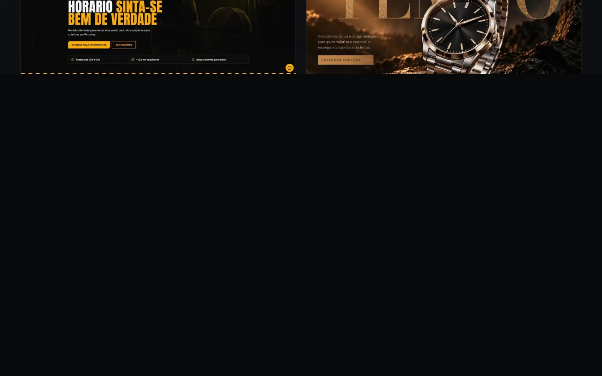
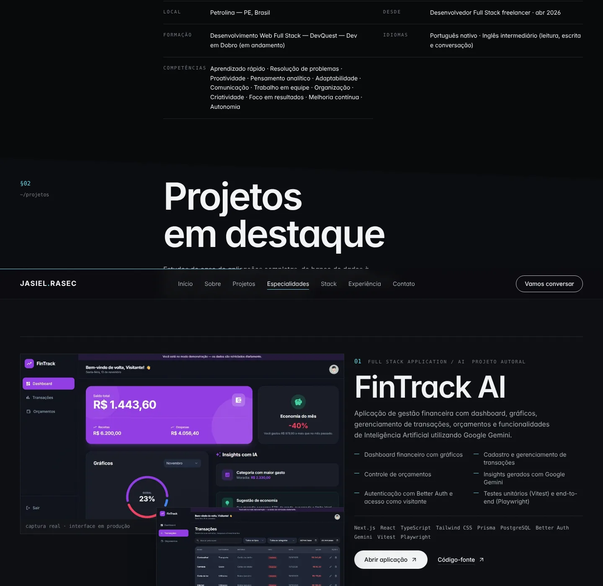
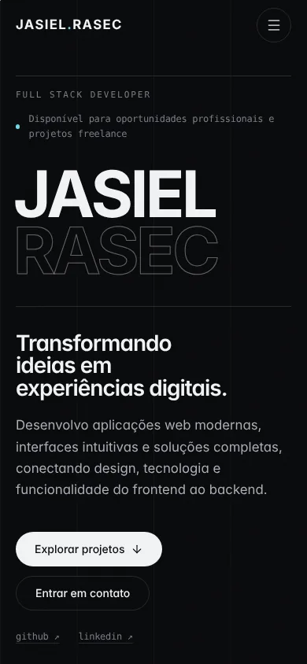

<div align="center">

# Jasiel Rasec — Portfólio

**Desenvolvedor Full Stack · Petrolina, PE — Brasil**

Portfólio com direção de arte editorial e cinematográfica, construído para demonstrar — no próprio site — domínio de interface, arquitetura de front-end, acessibilidade e performance.

[**Ver online**](__SITE_URL__) · [LinkedIn](https://www.linkedin.com/in/jasielrasec-dev/) · [GitHub](https://github.com/jasielrasec18-dev)




</div>

---

## Sumário

- [Sobre o projeto](#sobre-o-projeto)
- [Funcionalidades](#funcionalidades)
- [Stack](#stack)
- [Decisões técnicas](#decisões-técnicas)
- [Estrutura](#estrutura)
- [Como executar](#como-executar)
- [Variáveis de ambiente](#variáveis-de-ambiente)
- [Qualidade e testes](#qualidade-e-testes)
- [Deploy](#deploy)
- [Atualizando o conteúdo](#atualizando-o-conteúdo)
- [Contato](#contato)

## Sobre o projeto

O site apresenta trajetória, projetos e competências como uma narrativa em sete seções numeradas (`§01 … §07`). A identidade visual combina tipografia oversized, uma grade técnica de 12 colunas, metadados em fonte monoespaçada e referências a interfaces de desenvolvimento — tudo em uma paleta escura com ciano e violeta usados apenas como acento.

Todas as informações vêm do currículo e dos projetos publicados. Os projetos aparecem com **capturas reais** das versões em produção, e trabalhos comerciais são diferenciados de projetos autorais.

<table>
  <tr>
    <td width="72%"></td>
    <td width="28%"></td>
  </tr>
</table>

## Funcionalidades

**Experiência**
- Abertura curta com contador e revelação tipográfica do nome.
- Header fixo inteligente: transparente no topo, *backdrop blur* ao rolar, recolhe ao descer e reaparece ao subir; indica a seção ativa.
- Menu mobile em tela cheia, que fecha ao escolher uma seção e com `Esc`.
- Indicador de progresso de rolagem, revelação de textos por linha, *hover* com zoom sutil nas capturas, letreiro contínuo de tecnologias.
- Diagrama SVG animado do fluxo de uma requisição (client → ui → api → auth/db → ai).

**Conteúdo**
- Sete projetos como estudos de caso, com layouts variados: destaques (FinTrack AI, SyntaxWear), faixa de projeto comercial (Anny Beatriz) e grade complementar.
- Especialidades com glifos próprios, stack organizada por categoria com ícones oficiais (Simple Icons), timeline de experiência, formação e certificações.

**Contato**
- Formulário com validação por campo, mensagens acessíveis (`aria-live`), honeypot anti-spam, estados de envio, sucesso e erro.
- Envio real via [Formspree](https://formspree.io); sem endpoint configurado, o site exibe um aviso de configuração pendente e **não simula** o envio.
- Atalhos para e-mail, WhatsApp (mensagem pré-preenchida), LinkedIn e GitHub.

**SEO e acessibilidade**
- `title`, `description`, Open Graph e Twitter Card com imagem própria, dados estruturados `Person` (JSON-LD), `sitemap.xml`, `robots.txt`, manifest e favicon.
- HTML semântico, *skip link*, navegação completa por teclado, foco visível, `alt` e dimensões em todas as imagens, suporte a `prefers-reduced-motion` (abertura e animações desativadas, conteúdo intacto).

## Stack

| Camada | Tecnologias |
|---|---|
| Base | Vite 8, React 19, TypeScript 7 (strict) |
| Estilo | Tailwind CSS 4 (`@theme` com tokens de design), fontes variáveis locais via Fontsource — Bricolage Grotesque, Geist, JetBrains Mono |
| Movimento | Motion (`motion/react`) — apenas `transform` e `opacity` |
| Ícones | Lucide React (interface) e Simple Icons (marcas de tecnologia) |
| Formulário | Formspree (POST JSON) |
| Qualidade | oxlint, Playwright (auditoria automatizada) |
| Deploy | Vercel |

## Decisões técnicas

- **Conteúdo separado da apresentação.** Textos, projetos, experiência e links vivem em `src/data/` com tipos explícitos; os componentes só renderizam.
- **Sem dependências redundantes.** Uma única biblioteca de animação (Motion); o pacote de dados que percorre o diagrama usa CSS `offset-path`, sem JavaScript por quadro.
- **Imagens honestas.** `ProjectImage` usa a captura real quando ela existe em `screenshots.json`; sem captura, exibe uma lâmina neutra com a arquitetura documentada — nunca uma tela simulada.
- **Integração sem simulação.** O formulário só envia se `VITE_CONTACT_ENDPOINT` estiver definido; caso contrário, informa claramente a pendência.
- **Performance.** Capturas em WebP com `width`/`height` explícitos e `loading="lazy"` (a primeira com `fetchpriority="high"`); build dividido em *chunks* `react`, `motion` e aplicação para cache de longo prazo.

## Estrutura

```
├── docs/                    imagens deste README
├── public/
│   ├── projects/            capturas reais dos projetos (.webp)
│   ├── og.png               imagem de compartilhamento (1200×630)
│   └── favicon.svg, robots.txt, sitemap.xml, site.webmanifest …
├── scripts/
│   └── audit.mjs            auditoria Playwright
└── src/
    ├── components/          Header, Intro, ScrollProgress, ArchGraphic, Reveal,
    │                        SectionHeader, ActionLink, TechIcon, ProjectImage
    ├── sections/            Hero, About, Projects, Specialties, Stack,
    │                        Experience, Contact, Footer
    ├── data/                profile, projects, career, types, screenshots.json
    ├── hooks/               useActiveSection, useScrollState
    ├── lib/                 contact (validação e envio), icons, screenshots
    └── styles/index.css     tokens, utilitários editoriais e animações
```

## Como executar

Pré-requisitos: **Node.js 20+** e npm.

```bash
git clone https://github.com/jasielrasec18-dev/portfolio-jasiel-rasec-2.git
cd portfolio-jasiel-rasec-2
npm install
cp .env.example .env.local   # opcional: endpoint do formulário
npm run dev                  # http://localhost:5173
```

| Script | O que faz |
|---|---|
| `npm run dev` | Servidor de desenvolvimento com HMR |
| `npm run build` | Checagem de tipos (`tsc -b`) e build de produção em `dist/` |
| `npm run preview` | Serve o build localmente |
| `npm run lint` | Lint com oxlint |
| `npm run audit` | Build + auditoria automatizada (ver abaixo) |

## Variáveis de ambiente

| Variável | Obrigatória | Descrição |
|---|---|---|
| `VITE_CONTACT_ENDPOINT` | Não | URL do formulário que recebe `POST` JSON, ex.: `https://formspree.io/f/<id>`. Sem ela, o formulário fica desativado com aviso. |

> Variáveis com prefixo `VITE_` são públicas: o valor é incorporado ao bundle no build. Não use esse prefixo para segredos.

## Qualidade e testes

`npm run audit` gera o build, sobe um servidor local e executa o Playwright em **390, 768, 1440 e 2560 px**, verificando:

- erros de console e requisições com falha;
- `title`, meta description e JSON-LD;
- alvos de todas as âncoras e `rel="noopener"` nos links externos;
- ausência de rolagem horizontal;
- carregamento, `alt` e dimensões de todas as imagens;
- abertura/fechamento do menu mobile e navegação até a seção;
- validação do formulário e fluxo de envio — sucesso e erro, com a rede interceptada (nenhuma mensagem real é enviada);
- `prefers-reduced-motion`: abertura pulada e conteúdo visível.

Capturas de cada largura ficam em `./audit/` para revisão visual. O script usa o Chrome do sistema (`CHROME_PATH`, padrão `/usr/bin/google-chrome`).

## Deploy

O projeto está na **Vercel**, conectado a este repositório: cada push na `main` gera um deploy de produção, e cada pull request, um *preview*.

Para replicar:

1. Importe o repositório em [vercel.com/new](https://vercel.com/new) — o preset **Vite** é detectado (build `npm run build`, saída `dist`).
2. Em *Settings → Environment Variables*, importe o arquivo `.env.vercel` (ou crie `VITE_CONTACT_ENDPOINT` manualmente) para *Production* e *Preview*.
3. Ao trocar de domínio, atualize as URLs em `index.html` (canonical e Open Graph), `public/robots.txt`, `public/sitemap.xml` e `SITE_URL` em `src/data/profile.ts`.

## Atualizando o conteúdo

- **Textos e links:** `src/data/profile.ts` e `src/data/career.ts`.
- **Novo projeto:** adicione um objeto em `src/data/projects.ts` (o campo `kind` diferencia `cliente` de `autoral`; `layout` escolhe `feature`, `feature-reverse`, `commission` ou `compact`).
- **Captura de um projeto:** salve `public/projects/<slug>-01.webp` (e `-02` opcional) e registre largura/altura em `src/data/screenshots.json`.

## Contato

**Jasiel Rasec** — Desenvolvedor Full Stack

- E-mail: [jasielrasec18@gmail.com](mailto:jasielrasec18@gmail.com)
- LinkedIn: [in/jasielrasec-dev](https://www.linkedin.com/in/jasielrasec-dev/)
- GitHub: [@jasielrasec18-dev](https://github.com/jasielrasec18-dev)

---

<sub>© Jasiel Rasec. Código disponibilizado para consulta; conteúdo, textos e imagens dos projetos pertencem aos respectivos autores e clientes.</sub>
